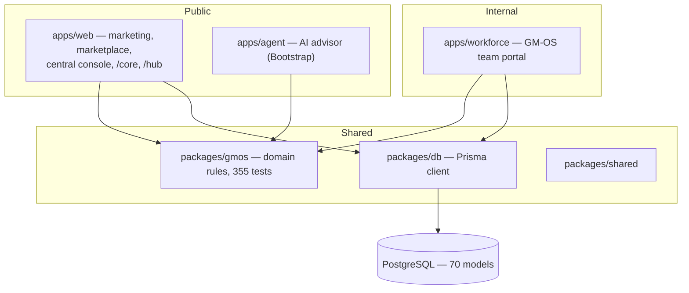

# Current state architecture

> Hand-written analysis, 11 August 2026. The mechanical baselines it refers to
> are generated by `scripts/discovery.mjs`.

## What this repository actually is

The product in this repository is **GM-OS** — a controlled-records, people and
pipeline platform built for Unskinned's own operation, deployed and
in production. `Unskinned Core` as named in `APP_Core_Developer_Exact_V2/` is the same
product line taken considerably further: GM-OS is roughly the Platform/Core layer
of the specification plus parts of HR and CRM, and does not yet contain the
enterprise finance stack, procurement, inventory, or any of the six sector
systems.

That is a statement about scope, not quality. The platform layer here is
stronger than the specification requires in several places — document control,
autonomy governance and the access matrix in particular.

## Topology

Three Next.js 15 applications, three shared packages, six service stubs, one
PostgreSQL database, deployed as Docker Compose behind a shared Caddy proxy.

| App | Host | Route handlers | Pages | Styling |
|---|---|---|---|---|
| `apps/web` | example.com, central., passive., core. | 105 | 60 | Tailwind v4 |
| `apps/workforce` | workforce.example.com | 37 | 27 | Tailwind v4 |
| `apps/agent` | ai.example.com | 6 | 1 | Bootstrap 5 |

Host routing is done in `apps/web/src/middleware.ts` — `central.` redirects to
`/central`, `passive.` rewrites to `/hub`, `core.` rewrites to `/core`. One
deployable serves four public identities.

## The domain layer

`packages/gmos` is the significant architectural asset. It holds the business
rules as pure functions with no I/O, which is why they are cheaply testable and
why there are 355 of those tests. Modules:

| Module | Lines | Concern |
|---|---|---|
| `agents.ts` | 557 | Agent registry, scopes, prohibitions |
| `org.ts` | 365 | Entities, branches, departments, reporting lines |
| `crm.ts` | 358 | Pipeline stages and transitions |
| `folders.ts` | 353 | Repository structure, create/move/delete rules |
| `packs.ts` | 320 | Required document packs per role |
| `config.ts` | 287 | The controlled configuration as types |
| `hr.ts` | 238 | Leave, working days, JML |
| `lifecycle.ts` | 210 | Document and task state machines |
| `autonomy.ts` | 208 | What may happen without a human |
| `storage.ts` | 189 | Content-addressed paths |
| `access.ts` | 178 | Zone grants, clearance, relationship |
| `tenancy.ts` | ~230 | Multi-tenant slug/schema/lifecycle rules |
| `compensation.ts` | 116 | Who may see pay |
| `totp.ts` | ~200 | RFC 6238, dependency-free |

This maps cleanly onto the specification's `IMPLEMENTATION_BOUNDARIES.md`
preference for platform services separate from domains, without a service split.

## Persistence

- PostgreSQL, Prisma ORM, **70 models / 36 enums** in `packages/db/prisma/schema.prisma`.
- A second schema, `control.prisma`, holds the multi-tenant control plane (5 models).
- **No migrations directory.** Deployment reconciles with `prisma db push`.
- Money is integer minor units (`Int // cents`), 12 fields. No `Decimal` anywhere.
- Documents are content-addressed on disk under their SHA-256, register in the database.

## Multi-tenancy — partially built

An architecture decision is recorded at
[`docs/architecture/001-tenant-isolation.md`](../architecture/001-tenant-isolation.md):
one PostgreSQL schema per tenant, connection carries the boundary, dedicated
database available for enterprise. The control-plane schema and the domain rules
(`packages/gmos/src/tenancy.ts`) exist and are tested. **Resolution, provisioning
and the client cache are not built**, so today the system runs single-tenant.

This matters for the specification's company-scope requirement: GM-OS currently
models multi-**company** (entities: `ORG-ES`, `ORG-CA`, …) inside one database,
and multi-**tenant** as a separate future boundary. Those are different axes and
both are required.

## Authentication and authorization

Four sign-in paths into the portal, all converging on
`apps/workforce/src/lib/after-auth.ts`: mailbox (IMAP credential check), magic
link, invitation, and an HMAC-signed 60-second SSO handoff from the central
console. TOTP second factor is required for approvers, group-wide roles and
holders of elevated capabilities.

Authorization is a matrix rather than a role check:
`zoneGrant(role, zone)` × `confidentiality` × relationship to the record, in
`packages/gmos/src/access.ts` and `permissions.ts`.

## Deployment

`infra/compose/docker-compose.prod.yml`, built and deployed by tar → scp →
`compose build` → `prisma db push` → `up`. Caddy terminates TLS and is **shared
with three unrelated projects** (partner-one, qlisted, entrequipos), so proxy
changes are surgical and validated before reload.

## Known structural debt

1. ~~**Stale duplicate trees**~~ — **resolved in Wave 1.8.** `web/` and `agent/`
   were copies of `apps/web` and `apps/agent` imported on 2026-07-30 (`0c0020d`)
   and untouched since, by which point `apps/` had moved 186 files ahead. Nothing
   built them, and they were a live hazard: a search hit them and an edit made
   there had no effect. Removed.

   `mobile/` is **not** an orphan and stays. It is the Capacitor wrapper for the
   iOS and Android app, which loads the hosted site; it is outside the workspace
   globs because it is a native shell, not a JavaScript workspace package. An
   earlier revision of this document listed it alongside the duplicates, which
   was wrong.
2. **No migration history.** `db push` cannot express a data migration, cannot be
   reviewed, and cannot be rolled back. Wave 1 decision item.
3. **`services/*` are stubs.** Six directories, 18 TypeScript files between them.
4. **45 of 148 endpoints show no recognised auth guard** — many legitimately
   public, but the list has not been triaged.
