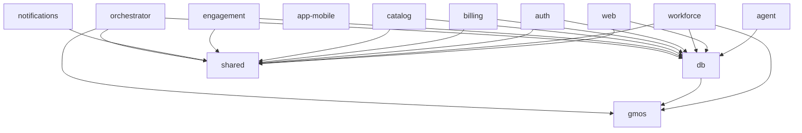

# Dependency map

> Generated by `scripts/discovery.mjs` on 2026-08-11. Do not edit by hand —
> re-run the script. Workspace graph and external dependency surface.

## Workspaces

`["packages/*","services/*","apps/*"]`

## Packages

| Package | Path | Internal deps | External deps |
|---|---|---|---|
| `@app/agent` | apps/agent | @app/db | 8 |
| `@app/web` | apps/web | @app/db, @app/shared | 16 |
| `@app/workforce` | apps/workforce | @app/db, @app/core, @app/shared | 14 |
| `app-mobile` | mobile | — | 10 |
| `@app/db` | packages/db | @app/core | 4 |
| `@app/core` | packages/gmos | — | 3 |
| `@app/shared` | packages/shared | — | 1 |
| `@app/auth` | services/auth | @app/shared, @app/db | 6 |
| `@app/billing` | services/billing | @app/shared, @app/db | 5 |
| `@app/catalog` | services/catalog | @app/shared, @app/db | 4 |
| `@app/engagement` | services/engagement | @app/shared, @app/db | 4 |
| `@app/notifications` | services/notifications | @app/shared | 6 |
| `@app/orchestrator` | services/orchestrator | @app/db, @app/core, @app/shared | 5 |

## Internal graph

## Trees outside the workspace globs

Listed, not condemned — a native shell legitimately sits outside a JS workspace.

- `mobile/` — has a package.json but is not in a workspace glob
